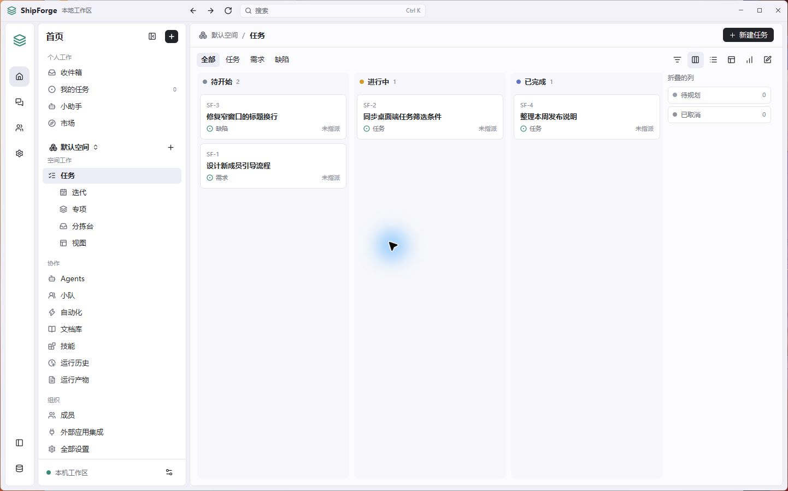

# ShipForge

ShipForge 是用 Rust 和 GPUI 编写的开源协作工作台。你可以在 Windows 本机管理任务、看板、迭代、专项、讨论与文档，也可以连接自托管服务，让团队成员和执行机器在同一空间工作。机器调用你配置的外部工具，将进度、回复和产物关联到任务。

**[下载 Windows x64 安装程序](https://github.com/Hubujiu/ShipForge/releases/latest) · [Windows 使用指南](docs/windows.md) · [CLI 手册](docs/cli.md)**

打开 ShipForge 即可创建第一条本地任务。想先看看有数据的看板，可在程序目录运行 `shipforge-desktop.exe --demo`。团队协作、外部工具和第三方同步按需配置。



| 文档 | 内容 |
| --- | --- |
| [Windows 功能对照](docs/windows-coverage.md) | 从参考能力定位到 Windows 实际入口，列明本机、团队及第三方接入范围。 |
| [Windows 实机截图与验收](docs/design-qa.md) | 查看原生看板、任务详情和定时规则编辑器，以及附件、重开和文档版本的测试结果。 |
| [功能清单与验收条件](docs/features.md) | 对照 HiFox 官网、帮助中心和 Windows 实机梳理的 26 项能力。 |
| [界面索引](docs/interfaces.md) | 36 个实机页面、面板和表单状态，含导航路径与可公开查看的官方参考。 |
| [客户端与 REA 分析](docs/client-analysis.md) | HiFox 0.4.538 安装包、可读模块恢复结果和桌面桥接职责。 |
| [Rust 与 GPUI 架构](docs/architecture.md) | 单机、团队服务、CLI 和执行机器的职责，以及设计目标与当前实现的区别。 |
| [命令协议](docs/protocol.schema.json) | 桌面、服务、CLI 共享的操作名称和 JSON 请求结构。 |

## 从源码运行

```powershell
cargo build --release --workspace --locked
.\target\release\shipforge-desktop.exe
```

产品参考来自 HiFox 官网和官方帮助。ShipForge 源码按 MIT 许可公开，应用图标授权见仓库随附文件。[HiFox 官网](https://hifox.com/) · [官方帮助](https://help.hifox.com/docs/welcome) · [MIT 许可证](LICENSE)
