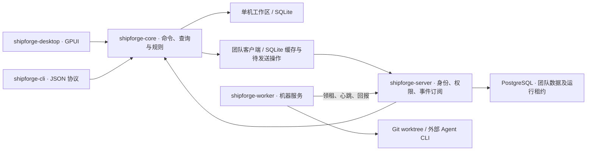

# Rust + GPUI 架构与交付顺序

ShipForge 面向共同维护一个空间的成员、Agent 和执行机器。最小的产品闭环是两名成员在同一看板上建单、指派、跟进并验收。GPUI 适合承载原生桌面窗口、键盘操作、长列表和后台任务；跨成员协作、离线同步和远程执行分别需要业务核心、协作服务和机器服务。以下是 ShipForge 的设计决策，当前仓库处于设计阶段。[GPUI 官方介绍](https://www.gpui.rs/) · [功能基线](features.md) · [HiFox 客户端取证](client-analysis.md)

## 组件和依赖方向

图中通向 core 的箭头表示复用同一组类型、校验和业务操作。命令层通过存储接口执行事务。单机适配器在本机提交，团队适配器将写请求交给服务端重新鉴权，并由服务端调用 core 提交。服务端持有本地事务处理实现，不再使用客户端的远程转发路径。

| 组件 | 拥有的职责 | 可单独核验的契约 |
| --- | --- | --- |
| `shipforge-core` | 实体、命令与查询、角色判断、状态流转、关联约束、运行资格、版本冲突和业务事件。依赖显式时钟和调用者身份。 | 固定输入和基准版本得到同一变更或同一个错误码；一次业务提交同时持久化变更与事件。 |
| `shipforge-desktop` | GPUI 窗口、导航、键盘焦点、草稿、详情和交互状态；把用户意图转换成 core 操作。 | 桌面建单、打开、筛选、指派和结项与 CLI 操作同一对象。演示数据只在显式的内存模式出现。 |
| `shipforge-cli` | 人类可读输出、版本化 JSON 输入输出和稳定的错误种类，适配本机和团队空间。 | 对每项新能力同步提供完整的 CLI 操作、生成的 schema、手册和随附 Skill。以同一组输入验证四者。 |
| `shipforge-server` | 团队数据权威、组织/空间授权、事件游标、运行排队、机器租约、文件引用和集成回调。首选单一服务配 PostgreSQL。 | 两客户端并发修改能检测冲突；权限收回后列表、对象读取、订阅和下载都服从最新授权。 |
| `shipforge-worker` | 机器注册、能力探测、容量上报、任务领取与续租、目录准备、外部进程和产物回传。 | 桌面关闭后，已接单机器仍能完成工作。桌面重开可凭运行号继续观察。 |
| 供应商适配器 | 将外部事件、身份、状态、评论和产物映射到 core 类型，记录外部对象标识和同步检查点。 | 相同外部事件连续投递两次只产生一次业务变更；回写到供应商的事件可识别来源。 |

## 数据模型与授权

| 数据组 | 关键关系与约束 |
| --- | --- |
| Organization、Space、Membership | 组织与空间角色分别保存，权限判断需要主体、动作、对象和所属范围。服务器从认证身份解析主体。个人文档、私有 Agent、团队可见机器分别检查访问范围。 |
| Task、TaskType、Status、Field、Tag、TaskRelation | 任务有稳定内部 ID 和空间内唯一的显示编号。真人负责人和当前处理人分字段，处理人可为成员、Agent 或小队。具体状态引用稳定的状态类别。父子与有向关系分开建模。 |
| Iteration、Project、View | 迭代属于空间。专项可关联多个空间，按成员可见范围聚合；每个任务最多一个专项。保存的视图保存有版本的查询定义与展示配置；查询每次计算实时结果。 |
| Comment、Thread、Notification、Document、Artifact | 评论归任务，对话可独立存在。提醒按接收人与事项聚合，每人有自己的处理游标。文档有版本和领域 ACL，产物有内容摘要、产生它的运行和源消息。 |
| Agent、Variant、Skill、Crew、Machine、Runtime | Agent 分身逐字段保存覆盖值，保留父配置关系。小队指明队长和所属空间。机器能力带最近探测时间。分派时记录解析后的配置、技能版本、工作策略与触发者。 |
| Run、Attempt、Event、Lease、Automation、ExternalLink | 一次业务触发绑定一个运行，可有多次尝试。记录接单机器、租约代次、取消状态、结果引用。外部映射包含供应商、连接与外部 ID 的唯一约束。 |

区分任务工作流和运行生命周期。任务可由人维护自定义状态；机器上报的是排队、运行、等待人工、成功、失败或取消。core 按项目配置把运行事件映射到允许的任务转换。例如，完成代码修改可以进入“待验收”，由负责人确认最终完成。准备阶段即可给待规划任务选择 Agent，进入可执行类别后才生成派发事件。[参考执行流程](https://help.hifox.com/docs/agent-and-computer/agent-task-execution)

## 一次指派如何落账

1. 桌面或 CLI 提交任务 ID、期望版本、处理人及唯一请求 ID。core 校验成员权、空间、状态与处理人资格。服务端在同一事务写入任务变更、业务事件和待派发记录，同一请求重放返回原结果。
2. 调度器按可见机器、Runtime、工作时段及可用容量筛选。当前无候选时保存等待原因。机器主动领取限时租约，检查返回的配置版本与执行策略；同一运行只接受当前租约代次发出的结果。
3. 隔离模式为运行准备独立 worktree；指定目录的直接执行模式按规范化目录持有互斥锁。多目录用固定排序取得全部锁再开始。机器调用用户配置的外部 Runtime，凭据以本机凭据库引用传递，日志和可共享配置只保留引用。
4. 机器以运行 ID、尝试号和递增序号回传事件。离线期间本机保存尚未确认的回报，重连后从确认点续传。任务、对话、产物和收件箱各能回链到同一次运行。
5. 取消先记入服务端，机器停止它持有的外部进程并回报实际状态。租约失效后隔离迟到的回报；涉及已产生的提交或外部副作用时，先核对产物再决定是否重试。工作目录清理仅针对本次运行创建并记录的目录。

HiFox 帮助给出了工作目录、运行时和排队的产品行为。租约、请求去重、事件序号和目录锁是 ShipForge 的实现选择。[工作目录](https://help.hifox.com/docs/agent-and-computer/working-directory) · [机器](https://help.hifox.com/docs/agent-and-computer/computers)

## 团队同步、离线和更新

- 团队工作区以服务器为权威。客户端缓存已获准读取的数据，将离线变更保存为带请求 ID 与基准版本的操作。界面显示“待同步”“已同步”或“需要处理冲突”。本地创建使用客户端生成的稳定 ID，显示编号由服务端分配。
- 写事务同时记录对象版本和事件游标。订阅断开后从已确认游标续传；游标过期则重取有权限的快照。不同字段可在明确策略下重新提交，同一字段冲突呈现双方值以供选择。权限变更时清除相应缓存并拒绝待发送的越权写入。
- 团队任务从缓存可读。指派、外部通知和自动化要等服务端确认才产生可执行事件。单机模式使用同一 core 与本地 SQLite，可独立完成任务管理的闭环。
- 项目数据与程序安装目录分离。自更新器只验证并替换程序；正常启动时执行带版本的迁移和备份。迁移中断后能恢复打开旧数据。引用用户绑定目录中的文件时只记录元数据，写入源文件必须来自用户明确发起的运行或编辑操作。

## GPUI 工作台

建议将窗口拆成 `WorkspaceShell`、空间导航、任务集合、详情面板、表单与命令面板。用共享的 `Route` 表达组织、空间、视图和对象，抽屉叠在原路由上。视图持有筛选草稿、选中项和滚动锚点，core 持有业务数据。列表按任务 ID 复用行，空列可折叠。桌面和 CLI 使用同一查询表达式、排序和分页边界。[界面索引](interfaces.md)

- **键盘与焦点**　为新建、搜索、返回和关闭设置应用动作。弹层打开时把焦点给第一个可编辑控件，Esc 逐层返回并把焦点交回触发元素。中文输入法候选确认优先于表单提交。
- **共享控件与动效**　原生文本框和选择触发器集中在 `controls.rs`，沿用 beUI 的 40% 前景边框、2 px / 40% 主题焦点环及 200 ms 过渡。行与页面共用 `motion::layout`，折叠项的稳定键包含空间或项目 ID。动画中途反向和系统减少动态效果均须可用。
- **列表、抽屉与后台任务**　列表按可见范围渲染；从原卡片打开详情保留查询与滚动位置。窄窗口优先显示当前详情，返回恢复原列表。磁盘、同步与 Runtime 探测在后台执行。切换页面后旧请求不得覆盖新选择。
- **空、慢、失败与只读**　空状态给出当前角色可以执行的下一步。把未启用、无数据、权限不足、机器离线和暂未交付分别呈现。依据任务号、机器号、运行号定位错误，失败的表单保留草稿。

## 分阶段交付

| 顺序 | 可以交给用户的结果 | 过关场景 |
| --- | --- | --- |
| 1 · 单机任务闭环 | 建立 Rust workspace、core、SQLite、CLI 和 GPUI。交付空间、任务、新建和详情、基础状态、看板/列表、筛选与保存视图。 | 创建一条任务并保存视图，从 CLI 改状态，重开桌面看到同一结果；打开旧版测试库验证迁移。 |
| 2 · 团队研发计划 | 上线协作服务、组织和空间成员、角色、增量同步，再补迭代、专项、分拣、关系、讨论和个人收件箱。 | 两名成员分别建单和分拣，手动结项并转走未完成项；离线修改遇上同字段冲突能恢复。 |
| 3 · 第一台执行机器 | 机器注册与心跳、外部 Runtime 适配、工作目录、单 Agent 指派、进度、人工回复、取消及产物。 | 待规划先指派，移到待办才运行；同仓库两任务可隔离执行，工作机断线重连后能追到唯一结果。 |
| 4 · 团队知识与协作执行 | Agent 分身、小队、技能版本、能力授权、独立对话、个人/团队文档、版本恢复和产物保存。 | 从小队任务追到子运行及最终报告，另一名有权限的成员可在文档库打开历史版本。 |
| 5 · 自动化与生态 | 定时/任务事件/Webhook、运行历史、一个代码托管适配器，再扩展项目管理和 IM。增加可重复部署、备份与恢复。 | 同一 Webhook 重放能去重，外部事件可追到任务和运行；用备份在第二台服务上恢复组织、权限和记录。 |
| 后续探索 | 移动客户端和可视化 Workflow 单独验证实际入口、数据契约和需求。 | 先写可执行的行为样例，再决定是否纳入版本承诺。 |

后续 Rust 改动通过分支和 PR 进入主线，Windows 与 Linux 均须通过格式、Clippy 和锁定依赖的测试。涉及打包时还需验证 Release 包与数据升级。当前文档 PR 的系统检查验证链接及功能和界面索引。
