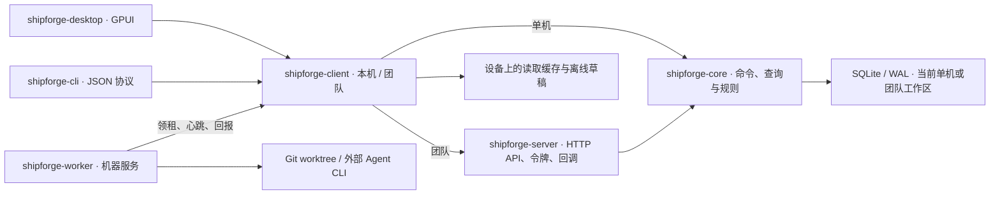

# Rust + GPUI 架构与交付顺序

ShipForge 面向共同维护一个空间的成员、Agent 和执行机器。GPUI 负责原生窗口、键盘操作、长列表和后台任务的界面。业务核心、团队服务和机器服务分别处理业务事务、跨成员授权及外部执行。下图对应 Windows 0.9.0 的组件，文末保留完整产品的分阶段验收目标。[GPUI 官方介绍](https://www.gpui.rs/) · [功能基线](features.md) · [HiFox 客户端取证](client-analysis.md)

## 组件和依赖方向

桌面、CLI 和执行机都使用 `shipforge-client`。单机模式由本机 core 在 SQLite 中提交事务。团队模式将业务请求交给服务端重新鉴权，并由服务端的 core 在 SQLite WAL 中提交事务。团队客户端使用按服务器和令牌区分的读取缓存与草稿数据库。跨设备部署使用 HTTPS 反向代理。事件推送、多实例 PostgreSQL 和移动客户端列入后续设计。[Windows 版本功能对照](windows-coverage.md)

| 组件 | 拥有的职责 | 可单独核验的契约 |
| --- | --- | --- |
| `shipforge-core` | 任务与计划、成员可见性、状态与关联约束、运行资格、版本冲突及业务事件。每次调用带入调用者身份。 | 记录写入与业务事件同事务提交。请求回执支持重试，复用同一记录请求 ID 时核对原始请求内容与当前权限。 |
| `shipforge-desktop` | GPUI 窗口、导航、键盘焦点、草稿、详情和交互状态；把用户意图转换成 core 操作。 | 桌面建单、打开、筛选、指派和结项与 CLI 操作同一对象。演示数据只在显式的内存模式出现。 |
| `shipforge-cli` | 人类可读输出、版本化 JSON 输入输出和稳定的错误种类，适配本机和团队空间。 | 对每项新能力同步提供完整的 CLI 操作、生成的 schema、手册和随附 Skill。以同一组输入验证四者。 |
| `shipforge-server` | 单实例服务通过 SQLite 管理团队数据、凭据、业务请求、Jira 兼容接口与授权回调。 | 两客户端并发修改可检测冲突。在线读取记录、拉取事件和下载附件时检查当前授权。 |
| `shipforge-worker` | 机器注册、能力探测、容量上报、任务领取与续租、目录准备、外部进程和产物回传。 | 桌面关闭后，已接单机器仍能完成工作。桌面重开可凭运行号继续观察。 |
| 供应商适配器 | 把工单和消息映射到空间任务，保留外部对象标识、投递标识和源版本。 | 十一种入站格式由 core 解析。GitHub Issues 由机器端拉取与显式回写。相同事件重投能找到同一任务。 |

## 数据模型与授权

设备账号目录保存服务地址、身份、加密凭据及最后访问的空间和对象 ID。Windows 使用当前系统用户的 DPAPI。切换账号会向该服务重新确认身份，再以当前权限读取上次的对象。团队服务的独立身份库只保存个人令牌的摘要和前缀，校验到期与吊销后才提交业务请求。服务后台按空间时区推进迭代，持续维护当前和未来的周期。[账号和令牌](cli.md) · [迭代维护](iterations.md)

| 数据组 | 关键关系与约束 |
| --- | --- |
| Organization、Space、Membership | 组织与空间角色分别保存，权限判断需要主体、动作、对象和所属范围。服务器从认证身份解析主体。个人文档、私有 Agent、团队可见机器分别检查访问范围。 |
| Task、TaskType、Status、Field、Tag、TaskRelation | 任务有稳定内部 ID 和空间内唯一的显示编号。真人负责人和当前处理人分字段，处理人可为成员、Agent 或小队。具体状态引用稳定的状态类别。父子与有向关系分开建模。 |
| Iteration、Project、View | 迭代属于空间。专项可关联多个空间，按成员可见范围聚合；每个任务最多一个专项。保存的视图保存有版本的查询定义与展示配置；查询每次计算实时结果。 |
| Comment、Thread、Notification、Document、Artifact | 评论归任务，对话可独立存在。提醒按接收人与事项聚合，每人有自己的处理游标。文档有版本和领域 ACL，产物有内容摘要、产生它的运行和源消息。 |
| Agent、Variant、Skill、Crew、Machine、Runtime | Agent 分身逐字段保存覆盖值，保留父配置关系。小队指明队长和所属空间。机器能力带最近探测时间。分派时记录解析后的配置、技能版本、工作策略与触发者。 |
| Run、Attempt、Event、Lease、Automation、ExternalLink | 一次业务触发绑定一个运行，可有多次尝试。记录接单机器、租约代次、取消状态、结果引用。外部映射包含供应商、连接与外部 ID 的唯一约束。 |

任务工作流由空间配置和负责人维护。机器运行另有排队、运行、等待人工、完成、失败或取消等状态。待规划任务可预先指派 Agent，进入可执行类别后才派发。执行完成时记录结果并回链任务，负责人可在任务详情检查产物、决定是否改为完成。[参考执行流程](https://help.hifox.com/docs/agent-and-computer/agent-task-execution)

## 一次指派如何落账

1. 桌面或 CLI 提交任务 ID、期望版本、处理人及唯一请求 ID。core 校验成员权、空间、状态与处理人资格。服务端在同一事务写入任务变更、业务事件和待派发记录，同一请求重放返回原结果。
2. 调度器按可见机器、Runtime、工作时段及可用容量筛选。当前无候选时保存等待原因。机器领取限时租约后，用心跳续租并获知取消请求。
3. 执行机根据默认工作区或指定 profile 选择一个批准的目录。隔离模式使用独立 Git worktree，也可在未绑定仓库时创建空目录。直接执行按规范化路径加系统文件锁。外部程序从机器配置读取，额外环境变量按本机清单传入。
4. 机器以运行 ID、机器身份和租约提交回报。未确认的回报在执行机暂存，重连后尝试重送。服务端按同一租约的结果摘要识别重复回报，并拒绝过期租约的新结果。任务或对话可追到关联运行与本次产物。
5. 取消先记入服务端，持租机器停止对应子进程并回报结果。租约丢失可导致运行中断。使用者查看已有产物后可显式重试。

HiFox 帮助给出了工作目录、运行时和排队的产品行为。ShipForge 的运行实现采用限时租约、请求去重和目录锁。[工作目录](https://help.hifox.com/docs/agent-and-computer/working-directory) · [机器](https://help.hifox.com/docs/agent-and-computer/computers)

## 团队同步、离线和更新

- 团队写入由服务器确认。离线可重开同一连接最近缓存的普通任务列表、详情、空间、仪表盘和文档历史，读取期限为 24 小时。保存视图的结果、任务讨论、对话及附件下载会向服务器重新确认权限。
- 可离线编辑的任务、评论、文档、视图、专项、迭代和消息进入设备的 SQLite 草稿队列。更新与删除需携带基准修订号。恢复连接后按顺序发送，遇冲突可读取当前记录，选择用新的基准重试或舍弃草稿。收到拒绝访问或找不到对象的响应后，清理该连接的读取缓存。
- 客户端通过重新查询刷新界面。`events` 按 `after` 游标查询当前权限下的业务记录变更。外部执行、通知和自动化在业务变更提交后才产生效果。
- 项目数据与程序安装目录分离，Windows 更新由新版安装程序覆盖程序文件。更新过程独立于业务数据库。完整数据备份可在关闭相关进程后复制数据目录，并在另一目录恢复验收。外部程序只有在运行配置与任务明确指定时才使用绑定仓库。[备份和更新](windows.md)

## GPUI 工作台

建议将窗口拆成 `WorkspaceShell`、空间导航、任务集合、详情面板、表单与命令面板。用共享的 `Route` 表达组织、空间、视图和对象，抽屉叠在原路由上。视图持有筛选草稿、选中项和滚动锚点，core 持有业务数据。列表按任务 ID 复用行，空列可折叠。桌面和 CLI 使用同一查询表达式、排序和分页边界。[界面索引](interfaces.md)

- **键盘与焦点**　为新建、搜索、返回和关闭设置应用动作。弹层打开时把焦点给第一个可编辑控件，Esc 逐层返回并把焦点交回触发元素。中文输入法候选确认优先于表单提交。
- **共享控件与动效**　原生文本框和选择触发器集中在 `controls.rs`，沿用 beUI 的 40% 前景边框、2 px / 40% 主题焦点环及 200 ms 过渡。行与页面共用 `motion::layout`，折叠项的稳定键包含空间或项目 ID。动画中途反向和系统减少动态效果均须可用。
- **列表、抽屉与后台任务**　列表按可见范围渲染；从原卡片打开详情保留查询与滚动位置。窄窗口优先显示当前详情，返回恢复原列表。磁盘、同步与 Runtime 探测在后台执行。切换页面后旧请求不得覆盖新选择。
- **空、慢、失败与只读**　空状态给出当前角色可以执行的下一步。把未启用、无数据、权限不足、机器离线和暂未交付分别呈现。依据任务号、机器号、运行号定位错误，失败的表单保留草稿。

## 原设计的分阶段验收目标

| 顺序 | 可以交给用户的结果 | 过关场景 |
| --- | --- | --- |
| 1 · 单机任务闭环 | 建立 Rust workspace、core、SQLite、CLI 和 GPUI。交付空间、任务、新建和详情、基础状态、看板/列表、筛选与保存视图。 | 创建一条任务并保存视图，从 CLI 改状态，重开桌面看到同一结果；打开旧版测试库验证迁移。 |
| 2 · 团队研发计划 | 上线协作服务、组织和空间成员、角色、增量同步，再补迭代、专项、分拣、关系、讨论和个人收件箱。 | 两名成员分别建单和分拣，手动结项并转走未完成项；离线修改遇上同字段冲突能恢复。 |
| 3 · 第一台执行机器 | 机器注册与心跳、外部 Runtime 适配、工作目录、单 Agent 指派、进度、人工回复、取消及产物。 | 待规划先指派，移到待办才运行；同仓库两任务可隔离执行，工作机断线重连后能追到唯一结果。 |
| 4 · 团队知识与协作执行 | Agent 分身、小队、技能版本、能力授权、独立对话、个人/团队文档、版本恢复和产物保存。 | 从小队任务追到子运行及最终报告，另一名有权限的成员可在文档库打开历史版本。 |
| 5 · 自动化与生态 | 定时/任务事件/Webhook、运行历史、一个代码托管适配器，再扩展项目管理和 IM。增加可重复部署、备份与恢复。 | 同一 Webhook 重放能去重，外部事件可追到任务和运行；用备份在第二台服务上恢复组织、权限和记录。 |
| 后续探索 | 移动客户端和可视化 Workflow 单独验证实际入口、数据契约和需求。 | 先写可执行的行为样例，再决定是否纳入版本承诺。 |

后续 Rust 改动通过分支和 PR 进入主线，Windows 与 Linux 均须通过格式、Clippy 和锁定依赖的测试。涉及打包时还需验证 Release 包与数据升级。发布流水线还验证安装包、覆盖安装、CLI 协议和多客户端团队操作。
